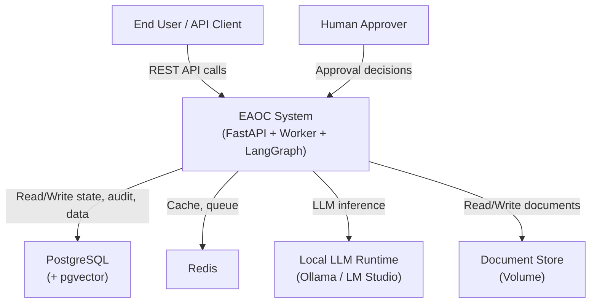
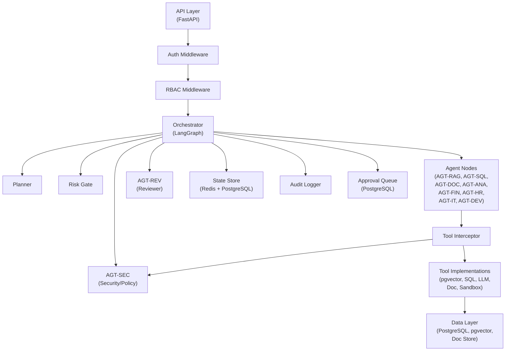
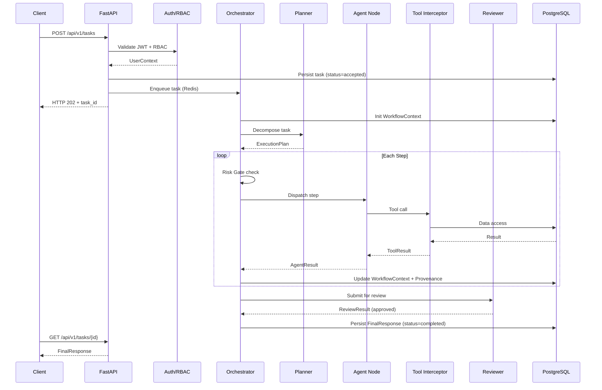
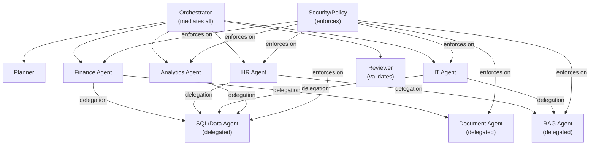
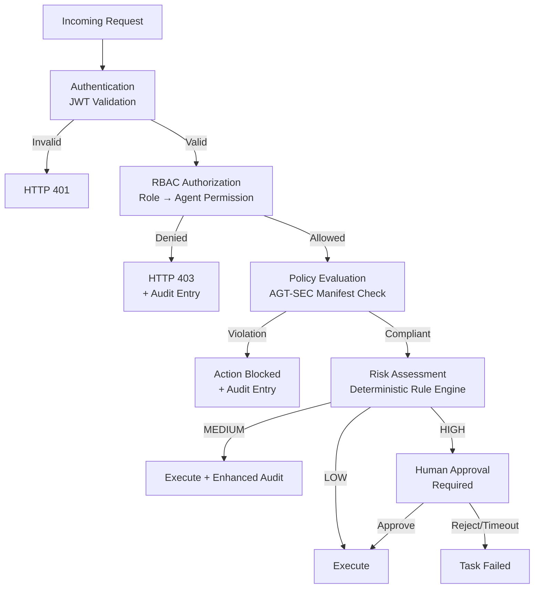
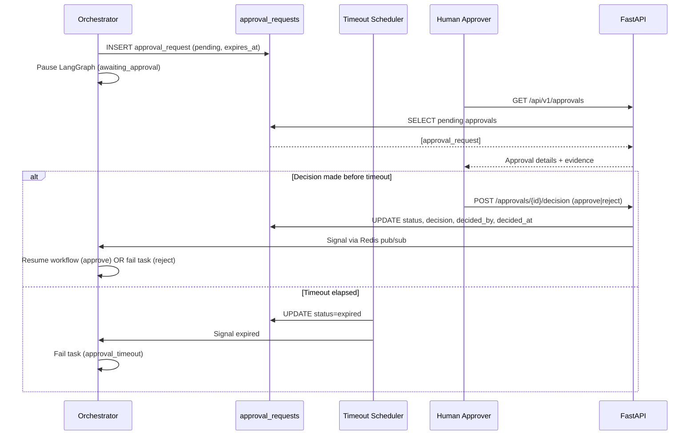
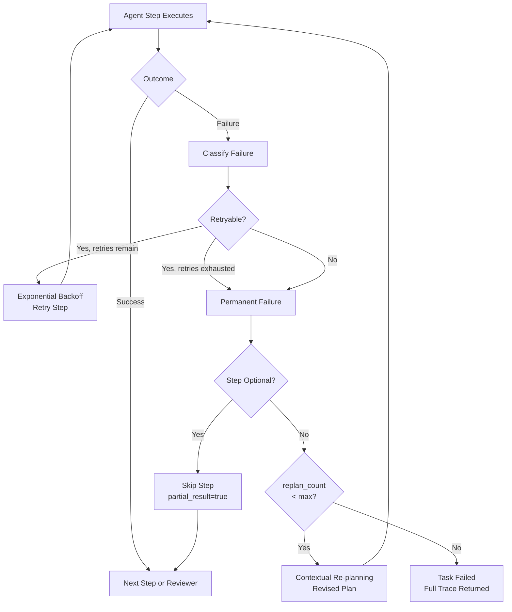
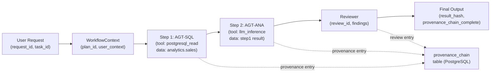
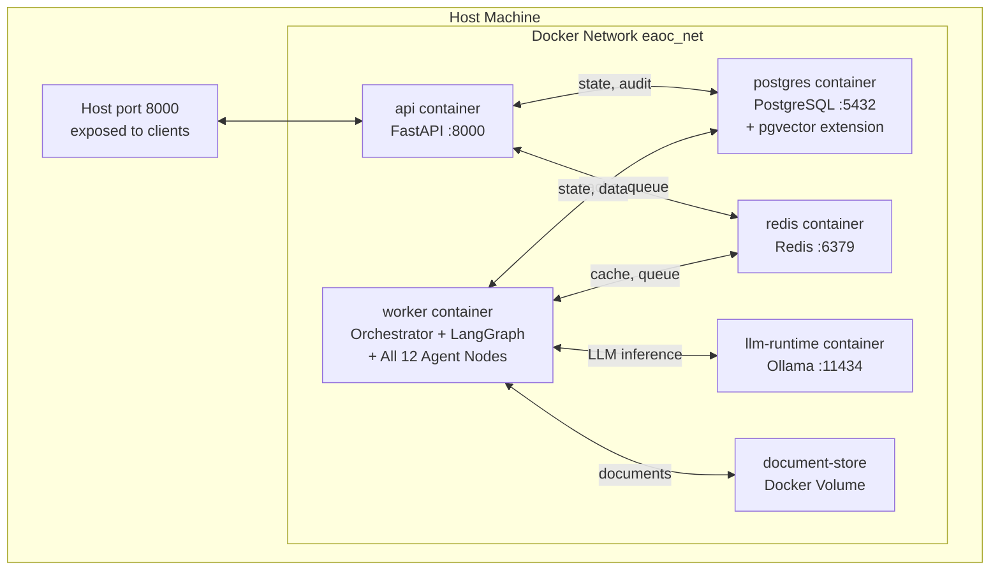

# EAOC — Detailed System Architecture Specification
# Part 0.3-C: Sections 11–15 (Provenance, Failure, Observability, Deployment, Diagrams)
# Phase 0 · Part 0.3 · Version 1.0

---

# SECTION 11 — PROVENANCE ARCHITECTURE

## 11.1 End-to-End Provenance Chain

Every task produces a complete provenance chain traceable from final output back to the original request:

```
User Request (request_id, task_id, user_id, timestamp)
  └─▶ Orchestrator (workflow initialised, WorkflowContext created)
        └─▶ Planner (plan_id, agent_sequence, risk_annotations, planning_rationale)
              └─▶ Step 1: Agent-N (agent_id, tool_used, data_source, action_summary)
              │     └─▶ Tool (tool_id, input_hash, output_ref, execution_time_ms)
              │           └─▶ Data Source (schema/namespace/document_id, query_ref)
              │                 └─▶ Agent Result (result_ref, evidence_ids)
              └─▶ Step 2 ... (same pattern)
                    └─▶ Reviewer (review_id, findings, risk_level, recommendation)
                          └─▶ Risk Decision (risk_level, gate_decision)
                                └─▶ [Human Approval if required]
                                      └─▶ Final Output (FinalResponse, provenance_summary)
```

## 11.2 Minimum Metadata Per Stage

| Stage | Required Metadata |
|---|---|
| User Request | request_id, task_id, user_id, roles, timestamp, task_description_hash |
| Orchestrator init | task_id, workflow_context_id, initial_status, plan_id |
| Planner | plan_id, task_id, plan_type, agent_sequence, risk_annotations, planning_rationale, model_used, timestamp |
| Each Agent Step | step_index, agent_id, tool_used, data_source, action_summary, input_ref, result_ref, evidence_ids, status, timestamp |
| Each Tool Call | tool_call_id, tool_id, agent_id, input_schema_version, input_hash, output_ref, execution_time_ms, status |
| Each Data Access | data_source_type, schema_or_namespace, query_ref_or_doc_id, access_level_used, row_count_or_chunk_count |
| Reviewer | review_id, task_id, findings_count_by_severity, risk_level, recommendation, model_used, timestamp |
| Risk Decision | risk_level, gate_decision (proceed|block|await_approval), rule_triggered |
| Human Approval (if used) | approval_id, approval_type, risk_level, decided_by, decision, decided_at |
| Final Output | task_id, final_status, result_hash, provenance_chain_complete: bool, warnings |

## 11.3 Provenance Retrieval API

```
GET /api/v1/tasks/{task_id}/trace
  → Auth: requires task-owner or admin role
  → Returns:
    {
      "task_id": str,
      "trace_complete": bool,
      "provenance_chain": [
        {
          "step_index": int,
          "agent_id": str,
          "tool_used": str | null,
          "data_source": str | null,
          "action_summary": str,
          "result_ref": str,
          "evidence_ids": [str],
          "timestamp": datetime,
          "status": str
        }
      ],
      "approval_records": [...],  # if any approvals were required
      "review_summary": {...}
    }
```

---

# SECTION 12 — FAILURE AND RECOVERY ARCHITECTURE

## 12.1 Failure Classification

| Failure Class | Examples | Retryable | Default Max Retries |
|---|---|---|---|
| `llm_failure` | LLM timeout, LLM connection refused | Yes | 2 |
| `tool_error` | Tool execution exception | Yes (if transient) | 1 |
| `database_unavailable` | PostgreSQL connection refused | Yes | 1 |
| `embedding_unavailable` | Embedding model offline | Yes | 1 |
| `vector_store_unavailable` | pgvector query failure | Yes | 1 |
| `schema_violation` | Agent output fails Pydantic validation | No | 0 |
| `permission_denied` | RBAC or manifest check failure | No | 0 |
| `policy_violation` | Security/Policy Agent blocks action | No | 0 |
| `plan_validation_failed` | Planner cannot produce valid plan | Yes (re-plan once) | 1 |
| `document_not_found` | Document missing from store | No | 0 |
| `approval_timeout` | Human did not decide within deadline | No | 0 |
| `sandbox_unavailable` | Dev sandbox offline | No | 0 |
| `unknown_failure` | Uncaught exception | Yes (1 retry) | 1 |

## 12.2 Retry Architecture

```python
RetryPolicy:
  failure_class: str
  max_retries: int
  initial_backoff_seconds: float  # default 2.0
  backoff_multiplier: float       # default 2.0 (exponential)
  max_backoff_seconds: float      # default 30.0
  jitter: bool                    # default true (prevents thundering herd)
```

Retry sequence for `max_retries=2, initial_backoff=2.0`:
- Attempt 1 fails → wait ~2s → retry
- Attempt 2 fails → wait ~4s → retry
- Attempt 3 fails → classify as permanent failure → no more retries

**Anti-infinite-loop guarantee**: `max_retries` is strictly enforced by the RetryPolicy engine. Once exhausted, the step transitions to permanent failure; no further retry scheduling is possible.

## 12.3 Circuit Breaker Architecture

```python
CircuitBreaker:
  dependency: str           # "llm" | "postgresql" | "redis" | "pgvector"
  failure_threshold: int    # default 3 (consecutive failures to open circuit)
  recovery_timeout_seconds: int  # default 30 (time before attempting half-open)
  states: CLOSED → OPEN → HALF_OPEN → CLOSED
```

**State transitions**:
```
CLOSED: normal operation
  → N consecutive failures → OPEN

OPEN: fast-fail all calls
  → after recovery_timeout: → HALF_OPEN

HALF_OPEN: allow one probe call
  → probe succeeds → CLOSED (normal)
  → probe fails → OPEN again
```

Circuit state stored in Redis (key: `circuit:{dependency}:state`) for sharing across threads.

## 12.4 Re-planning Architecture

```
Trigger: required step permanently fails AND replan_count < max_replan_attempts

Orchestrator → Planner(context):
  task_description: original task_description
  completed_steps: list of completed step results
  failed_step: StepFailureEvent
  remaining_steps: original remaining steps (not yet executed)
  constraint: "Do not repeat completed steps. Generate a revised plan for remaining steps only."

Planner generates RevisedPlan:
  steps: [only remaining steps, revised]
  replanning_rationale: str

Orchestrator resumes with RevisedPlan from current step index.
Revised plan re-enters full RBAC + Risk Gate + Policy checks.
replan_count incremented after each replanning cycle.
```

## 12.5 Graceful Failure Paths

| Scenario | Handling |
|---|---|
| Optional step fails (all retries) | Mark step as skipped; continue; FinalResponse includes partial_result=true |
| All retries exhausted + replan fails | Task status = failed; FinalResponse includes full failure trace |
| Reviewer rejects (all re-executions) | Task status = failed; FinalResponse includes Reviewer findings |
| Orchestrator crash mid-task | Recovery on restart; resume from last LangGraph checkpoint (PostgreSQL) |
| Redis unavailable | Fall back to PostgreSQL for state; continue with degraded performance |
| LLM circuit open | New tasks return 503; in-progress tasks pause; resume when circuit closes |
| Sandbox unavailable (DEV) | Step fails immediately (no retry); task fails gracefully |

---

# SECTION 13 — OBSERVABILITY ARCHITECTURE

## 13.1 Structured Logging

**Library**: `structlog` with JSON renderer.

**Mandatory context variables** (propagated via contextvars):
```
task_id, request_id, agent_id (when in agent scope), tool_id (when in tool scope)
```

**Log entry structure**:
```json
{
  "timestamp": "2026-09-28T17:00:00+05:30",
  "level": "INFO",
  "event": "step_completed",
  "task_id": "uuid",
  "request_id": "uuid",
  "agent_id": "AGT-SQL",
  "step_index": 2,
  "execution_time_ms": 3420,
  "row_count": 42
}
```

**Masking rules**: Fields named `password`, `token`, `secret`, `key`, `authorization` are masked to `***` before logging.

## 13.2 Metrics

**Library**: `prometheus_client`.

**Counters**:
- `eaoc_tasks_total{status}` — total tasks by final status
- `eaoc_agent_invocations_total{agent_id, status}` — per-agent invocations
- `eaoc_tool_calls_total{tool_id, agent_id, status}` — per-tool calls
- `eaoc_approval_requests_total{approval_type, decision}` — approval outcomes
- `eaoc_policy_violations_total{violation_type, agent_id}` — policy blocks
- `eaoc_retry_total{agent_id, failure_class}` — retries by failure class

**Histograms** (latency distributions):
- `eaoc_agent_duration_seconds{agent_id}` — per-agent execution time
- `eaoc_tool_duration_seconds{tool_id}` — per-tool execution time
- `eaoc_llm_inference_duration_seconds` — LLM call latency
- `eaoc_task_duration_seconds` — end-to-end task completion time
- `eaoc_api_request_duration_seconds{endpoint, method, status_code}` — API latency

**Gauges**:
- `eaoc_tasks_in_progress` — currently running tasks
- `eaoc_approvals_pending` — pending human approvals
- `eaoc_llm_available` (0|1) — LLM health flag
- `eaoc_db_available` (0|1) — PostgreSQL health flag

## 13.3 Distributed Trace Correlation

All log entries, audit entries, and metric labels share `task_id` and `request_id` for cross-component correlation.

**Correlation flow**:
```
HTTP Request arrives → RequestID Middleware assigns request_id
→ Auth Middleware attaches user_id
→ Task created → task_id assigned
→ task_id and request_id stored in structlog contextvars
→ Propagated to: agent nodes, tool calls, audit entries, provenance entries, metric labels
```

This enables: filtering all logs for a task_id to see the complete execution trace.

## 13.4 Health Check Architecture

**Endpoint**: `GET /api/v1/health` (unauthenticated)

**Health check components** (checked every 10 seconds by background coroutine):
```python
HealthStatus:
  overall: "healthy" | "degraded" | "unhealthy"
  components:
    database: ComponentHealth  # PostgreSQL SELECT 1
    redis: ComponentHealth     # Redis PING
    llm: ComponentHealth       # LLM /health or test inference
    document_store: ComponentHealth  # filesystem read test
```

**Overall status logic**: `min(component statuses)` — unhealthy if any critical component is unhealthy.

---

# SECTION 14 — DEPLOYMENT TOPOLOGY

## 14.1 Docker Compose Services

```yaml
services:
  api:
    image: eaoc-api
    # FastAPI application (Uvicorn ASGI server)
    # Serves: REST API endpoints
    # Depends on: postgres, redis

  worker:
    image: eaoc-api  # same image, different entrypoint
    # Background worker: Orchestrator + LangGraph execution
    # Processes tasks from Redis queue
    # Depends on: postgres, redis, llm-runtime

  postgres:
    image: postgres:15-pgvector
    # PostgreSQL with pgvector extension
    # Stores: all relational data, vector chunks, state, audit

  redis:
    image: redis:7-alpine
    # State cache, task queue, circuit breaker state

  llm-runtime:
    image: ollama/ollama  # or LM Studio equivalent
    # Local LLM inference server (OpenAI-compatible API)
    # Serves: text generation and embedding requests

  document-store:
    # Volume mount (no separate service needed initially)
    # Managed as a named Docker volume

  # Optional (Phase 7+ evaluation):
  # qdrant:
  #   image: qdrant/qdrant
```

## 14.2 Logical Deployment Diagram

```
┌─────────────────────────────────────────────────────────────────┐
│                    Docker Network: eaoc_net                      │
│                                                                   │
│  ┌──────────────┐     ┌──────────────────────────────────────┐   │
│  │  api         │     │  worker                              │   │
│  │  (FastAPI)   │     │  (Orchestrator + LangGraph + Agents) │   │
│  │  :8000       │     │  (background process)                │   │
│  └──────┬───────┘     └────────────┬─────────────────────────┘   │
│         │                          │                              │
│         └──────────┬───────────────┘                             │
│                    │                                              │
│         ┌──────────▼──────────┐   ┌────────────────────┐        │
│         │  postgres           │   │  redis              │        │
│         │  :5432              │   │  :6379              │        │
│         │  + pgvector ext.    │   │                     │        │
│         └─────────────────────┘   └────────────────────┘        │
│                                                                   │
│         ┌──────────────────────────────────┐                     │
│         │  llm-runtime (Ollama)            │                     │
│         │  :11434 (OpenAI-compat. API)     │                     │
│         └──────────────────────────────────┘                     │
│                                                                   │
│         ┌──────────────────────┐                                  │
│         │  document-store      │                                  │
│         │  (named volume)      │                                  │
│         └──────────────────────┘                                  │
└─────────────────────────────────────────────────────────────────┘
         │ (host port 8000 exposed)
         ▼
    External clients / API callers / Human Approvers
```

## 14.3 Agent Deployment Model

**Initial architecture**: All 12 logical agents run as Python modules within the `worker` container. They are LangGraph nodes in a single StatefulGraph, sharing one process and one LLM runtime connection.

**No separate microservice per agent** at this stage (see ADR-001).

**LLM sharing**: All agents that require LLM inference call the same local LLM runtime endpoint. The LLM is shared; agents are differentiated by their system prompts, tool access, and input/output schemas.

## 14.4 Scalability Considerations

- `api` service: stateless; can be horizontally scaled (multiple instances behind a load balancer) with no state sharing issues.
- `worker` service: initially single instance (task coordination via Redis queue). Horizontal scaling of workers requires distributed LangGraph state management — planned as a future architecture evolution.
- `postgres`: single instance for development and evaluation phases; PostgreSQL replication considered for production.
- `redis`: single instance for development; Redis Sentinel or Cluster for production.

---

# SECTION 15 — ARCHITECTURAL DIAGRAMS

## Diagram A: System Context



## Diagram B: Component Architecture



## Diagram C: Request Execution Sequence



## Diagram D: Agent Interaction (Mediated by Orchestrator)



## Diagram E: Security / Authorization Flow



## Diagram F: Human Approval Flow



## Diagram G: Failure / Recovery Flow



## Diagram H: Provenance Flow



## Diagram I: Deployment Topology


